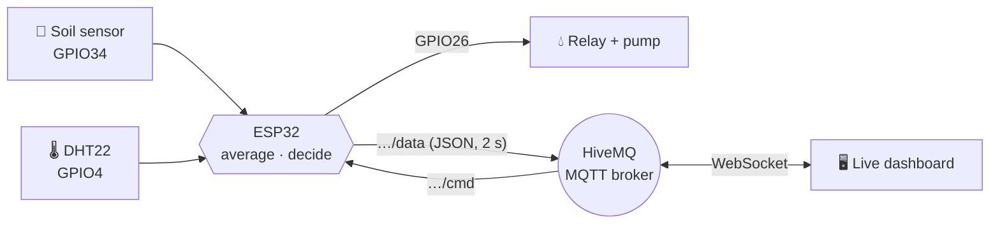
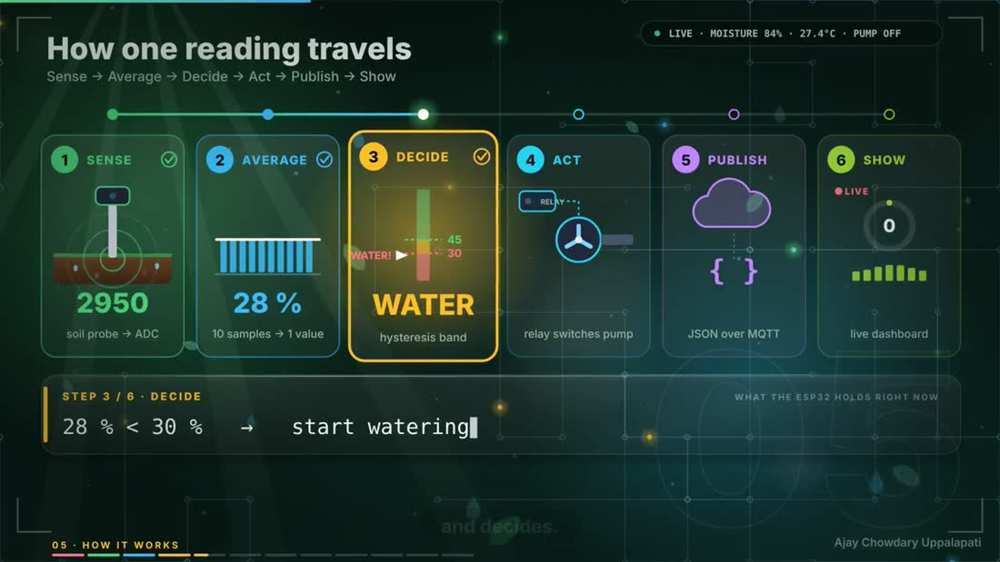
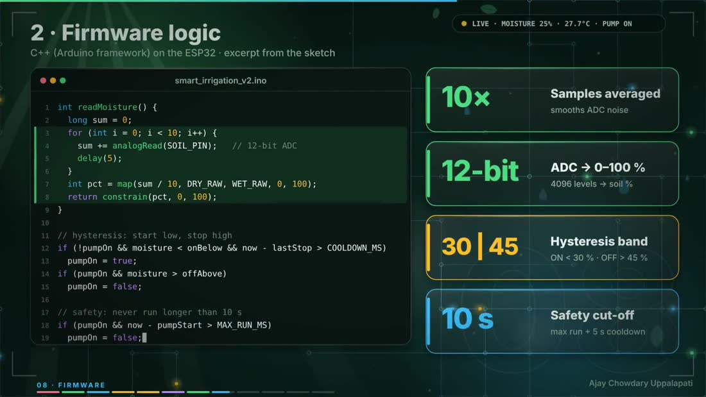
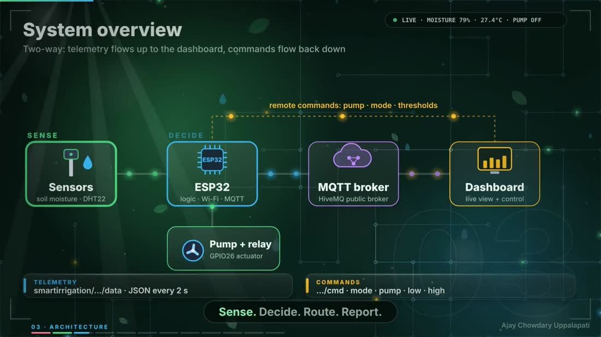
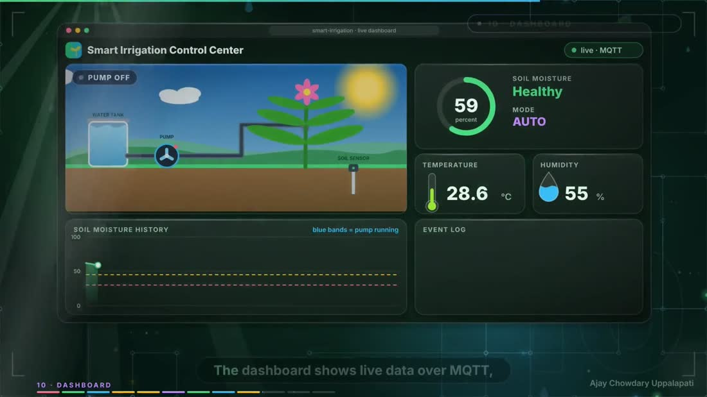

<p align="center">
  
</p>

<p align="center">
  <a href="https://YOUR-USERNAME.github.io/smart-irrigation-esp32/dashboard/irrigation_dashboard_v3.html?demo=1"></a>
  <a href="https://YOUR-USERNAME.github.io/smart-irrigation-esp32/"></a>
  <a href="LICENSE"></a>
</p>

<p align="center">
  
  
  
  
</p>

# 🌱 Smart Irrigation System

> **What if the soil could talk?**
> An ESP32 reads soil moisture, temperature and humidity, decides when to water using hysteresis control, publishes everything over MQTT, and a live browser dashboard lets you watch — and switch the pump from anywhere.

Built and tested entirely in the [Wokwi](https://wokwi.com) simulator — **no hardware needed to try it.**
By **Ajay Chowdary Uppalapati**, B.Sc. Horticulture.

<p align="center">
  
</p>

## ✨ Features

| | |
|---|---|
| 📡 **Live telemetry** | Moisture, temperature, humidity and pump state every **2 s** over MQTT |
| 🧮 **Smart averaging** | 10 ADC samples per reading smooth out sensor noise |
| 🎯 **Hysteresis control** | ON below **30 %**, OFF above **45 %** — the pump never flickers |
| 🛡️ **Safety first** | 10 s maximum run + 5 s cool-down in every mode |
| 🎛️ **Remote control** | Switch auto/manual, run the pump, change thresholds from the dashboard |
| 🖥️ **Dashboard** | Gauges, history chart, event log, animated field scene, built-in demo mode |

## 🧭 How it works



<p align="center"></p>

### Hysteresis in one picture

<p align="center"></p>

## 📁 Repository structure

```
smart-irrigation-esp32/
├── firmware/
│   └── smart_irrigation_v2.ino        # ESP32 firmware (Arduino C++)
├── dashboard/
│   └── irrigation_dashboard_v3.html   # Single-file live dashboard
├── docs/
│   ├── setup-guide.md                 # Run it in 5 minutes
│   ├── how-it-works.md                # Control loop explained
│   ├── mqtt-topics.md                 # Topics, JSON, commands
│   ├── hardware.md                    # Wiring & parts list
│   └── assets/                        # Animated SVGs, GIF, screenshots
├── wokwi/
│   ├── diagram.json                   # Simulator circuit
│   └── libraries.txt
├── index.html                         # Animated project page (GitHub Pages)
├── LICENSE                            # MIT
└── README.md
```

## 🚀 Quick start

1. **Simulate** — follow the [setup guide](docs/setup-guide.md): paste the firmware into a new Wokwi ESP32 project and press ▶.
2. **Watch** — open the [dashboard](https://YOUR-USERNAME.github.io/smart-irrigation-esp32/dashboard/irrigation_dashboard_v3.html) (add `?demo=1` to try it without a device).
3. **Control** — switch to manual and run the pump from the dashboard, or from a terminal:

```bash
mosquitto_pub -h broker.hivemq.com -t smartirrigation/ajay4821/cmd -m "pump:on"
```

## 🔌 Wiring

<p align="center"></p>

| Part | GPIO |
|---|---|
| Soil moisture sensor (analog) — potentiometer in Wokwi | 34 |
| DHT22 temperature + humidity | 4 |
| Relay → pump — LED in Wokwi | 26 |

## 📸 Screenshots

<table>
  <tr>
    <td></td>
    <td></td>
  </tr>
  <tr>
    <td></td>
    <td></td>
  </tr>
</table>

## ⚠️ Security note

The default setup uses the **public** HiveMQ broker with no authentication. Anyone who knows the topic can read the data **and send pump commands**.
Change the `ajay4821` topic id to something unique before sharing, and use a private broker with TLS + credentials for real hardware.
Details in the [setup guide](docs/setup-guide.md#3-make-the-topic-yours-important).

## 🗺️ Roadmap

- [ ] FreeRTOS tasks for sensing / control / networking
- [ ] Real hardware build with capacitive sensor and relay
- [ ] Solar power with battery monitoring
- [ ] Private broker with TLS and authentication
- [ ] Rain forecast integration

## 📄 License

[MIT](LICENSE) © 2026 Ajay Chowdary Uppalapati

---
<p align="center">If this helped you, drop a ⭐ — and tell me what you'd build next.</p>
