# Hardware & wiring

| Part | Pin | Notes |
|---|---|---|
| Soil moisture sensor (analog) | GPIO34 | Input-only ADC pin, 12-bit (0–4095). Power at 3.3 V |
| DHT22 | GPIO4 | Temperature + humidity; 10 kΩ pull-up if your module has none |
| Relay module → pump | GPIO26 | Active-high output. Separate supply for the pump, common GND |
| In Wokwi | – | Potentiometer replaces the soil sensor, LED replaces the pump |

## Bill of materials (real build)
- ESP32 DevKit
- Capacitive soil moisture sensor (corrosion-resistant)
- DHT22 (AM2302)
- 5 V relay module + small DC water pump + flyback diode
- External pump supply, jumper wires

## Calibration
Read the raw ADC value with the sensor in dry air (`DRY_RAW`) and in a glass of water (`WET_RAW`), then update both `#define`s.

## Safety
- Never switch mains voltage with a hobby relay unless you know what you are doing.
- Keep electronics away from water; waterproof the connections.
- The firmware limits one run to 10 s and enforces a 5 s cool-down — keep these protections.
