# How it works

Every 2 seconds the ESP32 runs one loop:

1. **Sense** — read the soil sensor 10 times (12-bit ADC), read the DHT22.
2. **Average** — mean of the 10 samples, mapped to 0–100 %.
3. **Decide** — hysteresis: start the pump below the *low* threshold, stop above the *high* threshold, hold state in between.
4. **Act** — drive GPIO26. A 10 s maximum run protects the pump (any mode), and a 5 s cool-down follows every stop before auto-mode can restart it.
5. **Publish** — send the JSON snapshot to `…/data`.
6. **Listen** — handle commands arriving on `…/cmd`.

Why two thresholds? With a single set-point (say 35 %) sensor noise would flip the pump on and off many times a minute.
The 30 → 45 band gives the soil time to respond and the relay time to rest.
